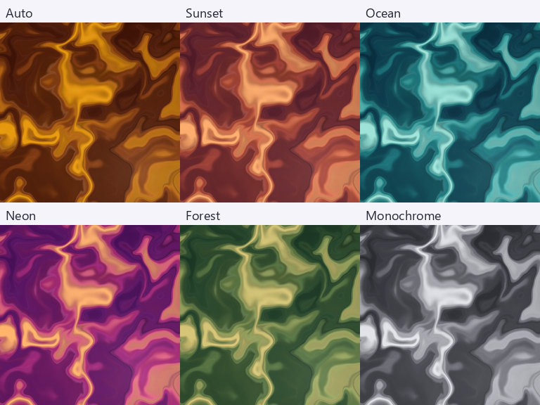
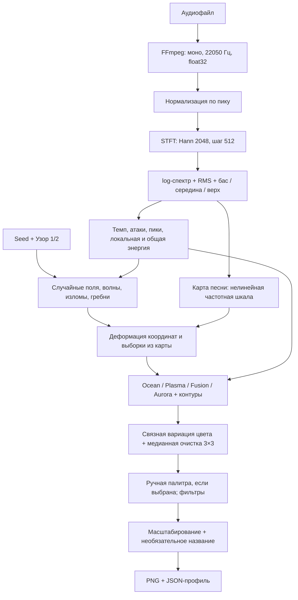
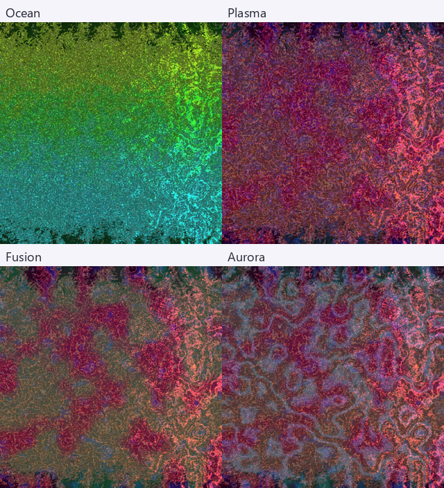
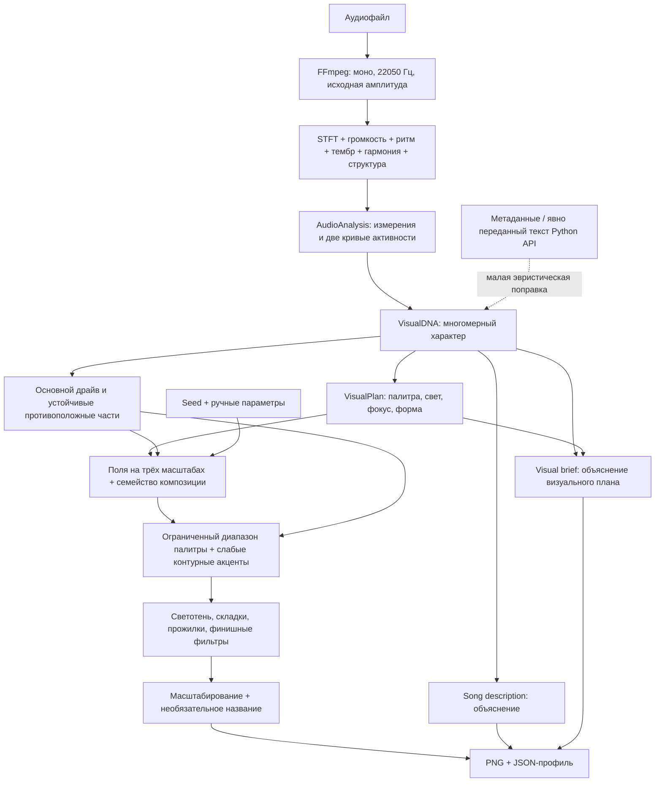
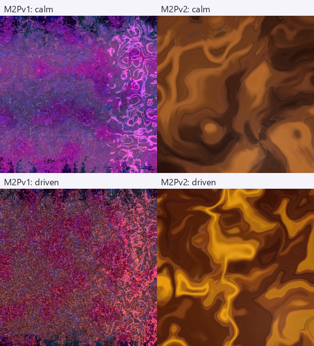
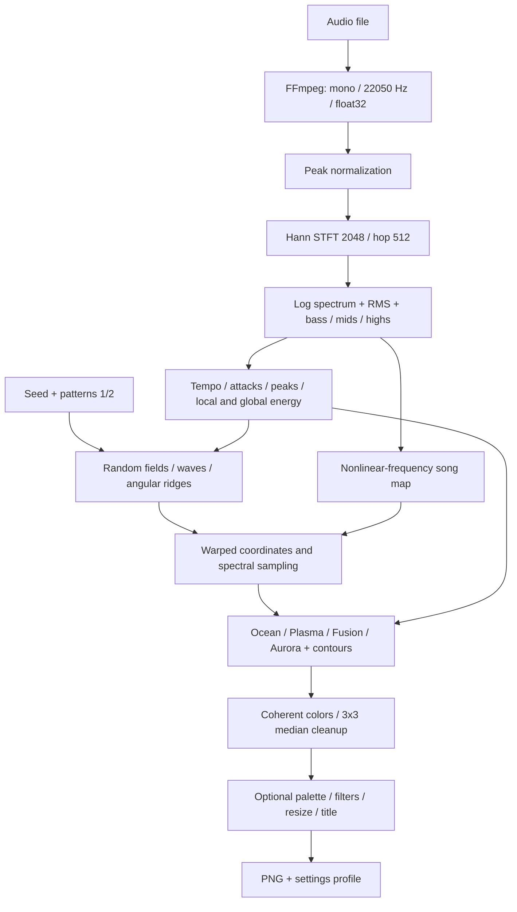
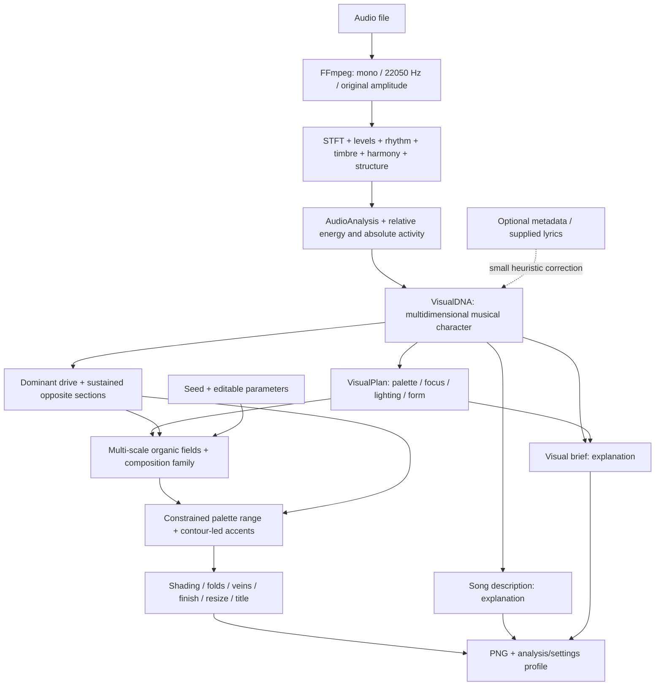

# Music2Picture — M2Pv1 и M2Pv2

[](https://github.com/dumuzeyn/Music2Picture/releases/latest)
[](https://github.com/dumuzeyn/Music2Picture/releases/latest)
[](#english)

Music2Picture превращает звучание в абстрактное квадратное изображение. Доступны **два разных алгоритма**, а не два названия одного фильтра:

| Поколение | Принцип | Результат |
| --- | --- | --- |
| **M2Pv1** | Спектральная карта, громкость и частотные полосы деформируются случайными полями, связанными с энергией | Классические сложные узоры, изломы и тонкие цветные контуры |
| **M2Pv2** | Многомерный анализ → VisualDNA → VisualPlan → органическая фактура | Потоки, складки, мраморные вихри, раскрытия и островки; характер звучания направляет выбор геометрии и цветов |

Релиз **2.1.0** объединяет оба движка в **M2P-Studio.exe** с редактируемыми параметрами. M2Pv1/M2Pv2 — поколения алгоритма, 2.1.0 — версия пакета. Это отдельная площадка для экспериментов, не аудиоредактор SonicForge.

## Windows: попробовать без Python

1. Скачайте `M2P-Studio.exe` из [релиза](https://github.com/dumuzeyn/Music2Picture/releases/latest).
2. Установите [FFmpeg](https://ffmpeg.org/download.html) и добавьте его `bin` в `PATH`. Альтернатива: рядом с EXE создайте папку `tools` и положите туда `ffmpeg.exe` и `ffprobe.exe`. **FFmpeg не включён в EXE**; без него аудио не декодируется.
3. Запустите EXE и нажмите **«Выбрать песню…»**. Поддерживаются MP3, FLAC, WAV, M4A, AAC, OGG, Opus и WMA.
4. Выберите M2Pv1 или M2Pv2. Дождитесь анализа: внизу показаны этап и движущийся индикатор.
5. Меняйте параметры, палитру и Seed. При включённом автообновлении предпросмотр пересоздаётся после короткой паузы. Быстрые изменения не запускают параллельные рендеры.
6. Нажмите **«Сохранить PNG…»**. Сохраняются полное изображение и JSON-профиль настроек.

**Предпросмотр и PNG-экспорт не переписывают песню, звук, текст или метаданные.** В GUI нет кнопки изменения MP3. Встраивание картинки и нормализация — отдельные явно выбранные Python CLI-команды ниже. Панель параметров прокручивается; настройки невыбранного движка скрыты или отключены.

## Редактируемые параметры

| Параметр | Диапазон | Что меняет |
| --- | --- | --- |
| Движок | M2Pv1 / M2Pv2 | Сам способ анализа и построения узора |
| Seed / «Другой вариант» | 0–2147483647 | Раскладку случайных полей. При одинаковой песне, версии, настройках и Seed результат повторяется. В авто-M2Pv2 семейство композиции по-прежнему выбирает музыка |
| Размер, px | 64–4096; GUI предлагает 512/1000/2048/4096 | Размер итогового квадратного PNG, не дополнительную музыкальную детализацию |
| Автоматическая детализация | Вкл. по умолчанию | M2Pv1 регулирует силу деталей по длительности/разнообразию; M2Pv2 сохраняет параметры, вычисленные из звука |
| Детализация | 0–100, после отключения авто | M2Pv1 — силу контуров без замены геометрии; M2Pv2 — средние/мелкие структуры, прожилки и фактуру |
| Режим цвета M2Pv1 | Ocean / Plasma / Fusion / Aurora | Четыре классических правила окраски, описанные ниже |
| Узор M2Pv1 | 1 / 2 | 1 — основные деформации; 2 — дополнительные волны, изломы и гребни. По умолчанию 2, включая короткие песни |
| Композиция M2Pv2 | Авто / пять семейств | Выбор по музыке либо ручной эксперимент при сохранении остальных измеренных характеристик |
| Настроение M2Pv2 | По музыке / спокойнее / меланхоличнее / энергичнее / напряжённее / романтичнее | Мягкую поправку valence/arousal/tension: 72% исходной оценки + 28% выбранного направления, без изменения звука |
| Цветовая схема | Авто / пять готовых / своя | Выбор оттенков; геометрия сохраняется |
| Свои цвета | Один или любое количество `#RRGGBB` через запятую | Упорядоченную палитру. Можно редактировать список и добавлять цвета через диалог. Позиции распределяются равномерно |
| Контраст | 50–150% | Светотеневые различия; 100% — без дополнительной коррекции |
| Насыщенность | 0–150% | 0% — чёрно-белый фон; 100% — исходная насыщенность рендера |
| Мягкость | 0–100% | Дополнительное размытие фона; 0% отключает этот пользовательский фильтр |
| Название по центру | Выкл. по умолчанию | Имя файла без расширения после фильтров: переносится по словам, не обрезается до фиксированной длины |
| Сброс | Кнопка | Возвращает параметры к умолчаниям, оставляя песню и движок |

Для чёткого классического узора оставляйте мягкость на 0. Высокий контраст может скрыть оттенки в тенях; высокая насыщенность не обязательно делает картинку красивее. Название добавляется после фильтров и не размывается вместе с фоном.

## Цветовые схемы

| Схема | Цвета слева → направо | Характер оформления |
| --- | --- | --- |
| Автоматическая | Вычисляются по песне | Исходные правила движка |
| Закат | `#25143B`, `#64365E`, `#AE4663`, `#EE6A53`, `#FFC078` | Фиолетовые тени, коралловые и тёплые акценты |
| Океан | `#0B1639`, `#173B69`, `#226B8F`, `#36B6BA`, `#BCEEE0` | Синий, бирюзовый и светлые морские оттенки |
| Неон | `#160F36`, `#45238F`, `#9F30C6`, `#F347A8`, `#FFD261` | Фиолетово-розовые и золотистые акценты |
| Лес | `#0D201F`, `#1B4837`, `#44805A`, `#90B067`, `#E8CB7F` | Зелёные, оливковые и тёплые светлые оттенки |
| Монохром | `#101018`, `#343442`, `#666674`, `#ACACB8`, `#F0F0F5` | Сравнение формы без цветовых отвлечений |
| Свои цвета | Ваш список, например `#102040, #407090, #E07060` | У M2Pv2 расположите спокойные цвета слева, энергичные справа |



Готовые палитры — оформление, **не классификатор жанров**. M2Pv2 использует ограниченный диапазон около основного характера, не растягивает каждую песню на все цвета. В M2Pv1 ручная палитра перекрашивает яркость уже созданного узора: правило «слева спокойствие, справа драйв» к этой перекраске M2Pv1 не применяется.

## M2Pv1 — подробно

Основа — [классическая реализация 342013a](https://github.com/dumuzeyn/Music2Picture/tree/342013aaa8bdb4cb86c8c14fec0acb038e50b5ca) с исправлением зернистости `classic-crisp-v2`. Это математический рендер, не набор заготовленных картинок.

### Схема образования картинки M2Pv1



### Сигнал и спектр

FFmpeg сводит аудио в моно 22050 Гц. M2Pv1 делит сигнал на максимальную абсолютную амплитуду: абсолютная громкость мастеринга не сохраняется отдельным признаком. Более тихая копия записи обычно даёт похожий классический анализ.

Окно Hann содержит 2048 отсчётов (около 93 мс), шаг — 512 (около 23 мс). Модуль FFT преобразуется через `log(1 + spectrum)`, берутся первые 512 положительных частотных ячеек и нормируются в 0–1. Это примерно нижняя половина положительного спектра, **не все частоты до 11 кГц**.

Для каждого окна считаются RMS, бас (первые 24 ячейки), середина (24–159), верх (160–511) и спектральный центр. При этом sample rate полосы приблизительно соответствуют 0–258 / 258–1723 / 1723–5500 Гц. Карта растягивается по времени и использует частотную шкалу со степенью 1.65: низкочастотные изменения получают больше места.

### Темп и энергия

Глобальный BPM оценивается по изменениям RMS, локальный — по басовым атакам в 15-секундных окнах. Возможны ошибки половинного/двойного темпа; отдельная партия ударных не выделяется. Энергия смешивает темп, плотность атак, спектральные изменения, RMS-контраст, сильные пики, басовые удары и верхние частоты. Есть общая оценка песни и кривая локальных изменений; одинаковый BPM не гарантирует одинаковую обложку.

### Формы и контуры

Seed создаёт несколько интерполированных случайных полей. Они задают мягкие перемещения, угловатые изломы и мелкую фактуру. Энергия и пики определяют, как поля деформируют координаты выборки спектральной карты. Узор 2 добавляет синусоидальные волны, треугольные деформации, полосы и прерывистые гребни.

После деформаций это уже не читаемая спектрограмма: по завитку нельзя восстановить ноту, слово или точное время. Seed меняет расположение полей, не саму музыку.

| Режим | Принцип окраски |
| --- | --- |
| Ocean | Оттенок зависит главным образом от локального BPM; насыщенность/светлота — от спектра, RMS, полос и пиков |
| Plasma | Энергетическая шкала от тёмно-фиолетовых к розово-коралловым и тёплым оттенкам плюс горячие/холодные полосы |
| Fusion | Энергетическая основа с более выраженными синими, зелёными и тёплыми примесями |
| Aurora | Энергетическая основа плюс протяжённые бирюзово-фиолетово-розовые световые полосы |



Градиенты полей и гребни создают тонкие контуры. Текущая очистка **сохраняет исходные поля и координаты деформаций**: независимая случайность цвета каждого пикселя заменена связной вариацией; резкое переключение светлого/тёмного тона контура стало плавным. Медианный фильтр 3×3 удаляет одиночные выбросы, а не размывает всё изображение Gaussian Blur. Пользовательская «Мягкость» — другой, необязательный фильтр.

Автоматическая детализация лежит примерно в 20–60, учитывает длительность и разброс энергии и регулирует силу деталей. Она **не заставляет короткую песню использовать упрощённый узор 1**. Рабочая сторона ограничена 1000 px; большой экспорт масштабируется Lanczos, без новых слоёв зерна.

Код: [анализ и геометрия](music2picture_v1/core.py), [обёртка и размер](music2picture_v1/renderer.py).

## M2Pv2 — подробно

Актуальная реализация `contour-character-v5` переводит независимые характеристики звука в органическую фактуру. Основной характер управляет геометрией и частью палитры; противоположная часть песни добавляет небольшую примесь, не заменяет всю композицию.

### Схема образования картинки M2Pv2



**Описания объясняют решения, но не управляют текстовым генератором.** Рендер читает VisualDNA, VisualPlan и числа напрямую. Изменение строки `song_description` или `visual_brief` само по себе картинку не меняет. Текст не отправляется стороннему сервису.

### AudioAnalysis: что измеряется

Сигнал не нормализуется по пику: сохраняются абсолютный уровень и амплитуда записи. FFT использует окно 2048 и базовый шаг 512; для длинного материала шаг увеличивается, ограничивая число окон примерно 7500. В анализе участвует весь временной диапазон, не только начало песни.

| Группа | Измерения | Смысл и ограничения |
| --- | --- | --- |
| Громкость | Пик, RMS dBFS, процентили 10/50/90, crest factor | Уровень и отношение пиков к среднему; **не LUFS** |
| Динамика | Разброс уровней и относительная кривая | Изменения внутри записи; отделены от абсолютной громкости |
| Ритм | Onset strength/density, автокорреляционный BPM, confidence, регулярность | Сила/плотность/повторяемость атак; слабая уверенность уменьшает влияние темпа |
| Тембр | Центр/rolloff спектра, contrast, flatness, flux, zero crossing rate | Яркость, шумоподобность, частотные изменения, резкость |
| Полосы | Энергия 20–220, 220–2500, >2500 Гц | Басовая, средняя, высокочастотная масса |
| Гармония | Chroma из 12 компонентов, тональность/лад/confidence, энтропия, изменения chroma | Приближённая сложность, **не точная последовательность аккордов** |
| Гармоника/перкуссия | Медианные оценки по времени/частоте | Устойчивое тональное/ударное содержимое, не отдельные дорожки |
| Структура | 64-точечная energy_curve, переходы, контраст секций, кульминация | Относительное развитие записи |
| Локальный характер | До 64 точек activity_curve, окна около нескольких секунд | Абсолютная активность участков; тишина отмечена отдельно |

Кривые решают разные задачи: `energy_curve` показывает относительные подъёмы внутри песни, `activity_curve` отличает действительно спокойную музыку от драйвовой без растягивания каждой записи на 0–1. Самый громкий участок тихой песни не становится автоматически максимально энергичным.

### VisualDNA: признаки, не «чтение эмоций»

VisualDNA объединяет измерения в нормированные признаки arousal, valence, tension, aggressiveness, relaxation, brightness, warmth, roughness, bass_mass, rhythmic_density, harmonic_complexity и другие. Это прозрачные инженерные эвристики, **не объективное измерение эмоций человека**.

Например, arousal смешивает абсолютную энергию 27%, ритмическую плотность 20%, темп с confidence 13%, атаки 18%, спектральные изменения 12% и контраст секций 10%. Один BPM не определяет всё. Метаданные/явно переданный текст Python API дают поправку по спискам слов максимум 18%. В GUI метаданные — имя файла; слова не распознаются и не скачиваются. Ручное настроение — отдельная мягкая поправка 28%.

### Основной характер и контрастные части

Общая оценка драйва использует ритмическую плотность 35%, темп с confidence 24%, атаки 20%, arousal 13% и абсолютную громкость 8%, затем калибруется. Если есть activity_curve, итог смешивает 85% медианной локальной активности и 15% общей оценки.

Противоположный участок должен отличаться от локальной медианы более чем на 0.17 и занимать хотя бы две соседние точки. Щелчок, одно переходное окно и тишина не создают акцент. Доля примеси ограничена 12%, локальная сила — 0.34: **это веса смешивания, не обещание ровно 12% площади изображения**.

Акценты следуют существующим полосам фактуры: спокойная часть быстрой песни даёт слабую левую примесь палитры; энергичная часть медленной — правую. Отдельное случайное пятно не рисуется.

### VisualPlan, композиция и поверхность

План выбирает палитру, контраст, светлоту, размер/положение фокуса, плотность и поток из VisualDNA. Основной оттенок учитывает оценённую тональность, теплоту, valence и небольшой fingerprint-сдвиг. Это художественное правило, не физический закон «нота = цвет».

Автоматический выбор семейств проверяется **по порядку**:

| Семейство | Условие, если предыдущие не сработали | Видимый характер |
| --- | --- | --- |
| Островки / cellular_islands | Flatness >0.6, плотность ритма <0.35 | Ячеистые органические области |
| Складки / folded_currents | Драйв >0.55, регулярность >0.58 | Направленные повторяющиеся течения |
| Диагональный поток / diagonal_pour | Драйв >0.65 либо агрессивность >0.7 | Более активная направленная композиция |
| Радиальное раскрытие / radial_bloom | Басовая масса >0.6, драйв <0.45 | Широкие формы вокруг фокуса |
| Мраморный вихрь / vortex_marbling | Драйв >0.4 | Закрученные мраморные потоки |
| Складки / folded_currents | Остальные случаи | Более спокойные и свободные течения |

Это **семейства математической геометрии, не готовые шаблоны**. Музыка непрерывно меняет масштабы, деформацию, турбулентность, прожилки, направление и свет; Seed варьирует расположение полей. Ручная композиция намеренно обходит автоматический выбор.



Крупные, средние и мелкие многооктавные поля деформируют координаты и создают течения/складки/ячейки. Периодическая интерполяция не допускает резкого шва при оборачивании координат. Светлые прожилки и соседние тени следуют форме, не накладываются случайными дисками.

### Палитра и финальный размер

Автоматическая палитра состоит из пяти упорядоченных оттенков одной цветовой среды. Используемый диапазон имеет ширину `0.34 + 0.10 × harmonic_complexity`, центр — около основного драйва. Для спокойного характера ограничивается правая граница, для выраженного драйва — левая. Песня не обязана использовать все оттенки.

Именованная/своя палитра поступает **сразу в рендер**, без повторной полной перекраски. Геометрия даёт светотень, характер — диапазон, противоположные секции — слабые контурные примеси. Один цвет тоже сохраняет тональные варианты.

Полный рендер работает на стороне до 640 px и масштабируется Lanczos. GUI использует этот же полный режим, а не отдельную упрощённую композицию. Python API `preview=True` ограничивает рабочую сторону 384 px: мелкие детали могут отличаться. Лёгкий финиш и слабое монохромное зерно создают материал, не обещают абсолютно бесшумную поверхность.

Код: [анализ](music2picture_v2/audio_analysis.py), [VisualDNA/описания](music2picture_v2/semantics.py), [характер/акценты](music2picture_v2/character.py), [план](music2picture_v2/visual_plan.py), [рендер](music2picture_v2/renderer.py).

## Исходники, CLI и Python API

Нужен Python 3.10+ с Tkinter, NumPy/Pillow и FFmpeg/FFprobe в PATH. Windows EXE проверяется на Python 3.12 x64.

```powershell
python -m pip install -r requirements.txt
python .\music2picture.py gui
python .\music2picture.py covers --source "C:\Music\song.mp3" --output "C:\Music\covers" --engine M2Pv2 --seed 42
python .\music2picture.py covers --source "C:\Music\song.mp3" --output "C:\Music\covers" --engine M2Pv1 --patterns 2 --color-mode plasma --detail 45 --seed 42
```

Своя палитра, композиция и фильтры:

```powershell
python .\music2picture.py covers --source "C:\Music\song.mp3" --output "C:\Music\covers" --engine M2Pv2 --composition vortex_marbling --color-scheme custom --colors "#102040,#407090,#E07060" --contrast 110 --saturation 95 --softness 0 --center-title
```

Готовая палитра: `--color-scheme sunset`, `ocean`, `neon`, `forest` или `mono`. Для автодетализации не указывайте `--detail`. `--mood`/`--composition` относятся только к M2Pv2; `--patterns`/`--color-mode` — только к M2Pv1.

Папки обходятся рекурсивно и последовательно с сохранением относительной структуры; ошибка одного трека не отменяет остальные. Для одного файла ошибка возвращается вызывающему коду.

```powershell
python .\music2picture.py covers --source "C:\Music\Input" --output "C:\Music\covers" --engine M2Pv2
python .\music2picture.py describe --source "C:\Music\Input" --output "C:\Music\descriptions"
python .\music2picture.py describe --source "C:\Music\Input" --regenerate
```

`describe` относится к M2Pv2. Кэш описаний: `%LOCALAPPDATA%\Music2Picture\analysis\track_descriptions.json` либо домашняя папка/Music2Picture, если LOCALAPPDATA отсутствует. Проверяются путь, размер, mtime и версия пайплайна; fingerprint записан в анализе, но не пересчитывается при каждом чтении кэша. In-memory LRU ограничен 12 записями. GUI повторно использует неизменённый анализ; рендер идёт одним рабочим потоком, Tkinter обновляется главным.

```python
from pathlib import Path
from music2picture import make_cover
from m2p_controls import RenderOptions, render_with_options

make_cover("song.mp3", "classic.png", engine="M2Pv1", color_mode="aurora", seed=42)
make_cover("song.mp3", "modern.png", engine="M2Pv2", color_scheme="ocean", seed=42)
image = render_with_options(Path("song.mp3"), RenderOptions(
    engine="M2Pv2", seed=42, detail=65, color_scheme="custom",
    colors=("#102040", "#6090B0", "#F08060")))
image.save("custom.png")
```

Профиль `.m2p/<имя>.profile.json` содержит поколение движка, версию, Seed, настройки, путь исходника и для M2Pv2 AnalysisBundle. **Проверьте локальные пути перед публичной публикацией профиля.**

### Явные операции, изменяющие файлы

`covers --embed-cover` **меняет исходные MP3**: заменяет только APIC-обложку, сохраняя USLT/SYLT, другие ID3-фреймы и аудиобайты. Поддерживаются стандартные ID3v2.3/2.4; сложные/повреждённые заголовки отвергаются, не переписываются с потерями. Для остальных контейнеров встраивание пропускается. Перед изменением метаданных сделайте резервную копию.

`process` — отдельная совместимая команда нормализации, **не этап генерации картинки**. FFmpeg loudnorm перекодирует звук в MP3 в выходной папке. По умолчанию: -14 LUFS, true peak -1.5 dBTP, LRA 11, final gain 1.0.

```powershell
python .\music2picture.py process --source "C:\Music\Input" --output "C:\Music\Normalized" --integrated-lufs -14 --true-peak -1.5 --lra 11 --final-gain 1
```

## Ограничения, проверка и сборка

- Нет распознавания слов/инструментов/жанров или точной транскрипции аккордов. Гармонические и эмоциональные оценки приблизительны.
- Картинка художественно связана с признаками, но не доказывает «истинный характер» песни. Похожие признаки могут дать похожий вид.
- Стерео сводится в моно. Оба анализатора декодируют запись целиком: очень длинные файлы требуют памяти. Ограничение FFT-окон M2Pv2 не равно полностью потоковой обработке.
- Повторяемость требует одинаковых аудиоданных, ревизии движка, параметров, Seed и рабочего разрешения. Изменение алгоритма может изменить результат.
- Музыка не отправляется на сервер. FFmpeg — отдельная локальная программа; это не гарантия отсутствия уязвимостей сторонних компонентов.
- EXE — неподписанная Windows x64-сборка. Возможен SmartScreen: скачивайте здесь, проверяйте SHA256, **не отключайте защиту Windows**.

```powershell
python -m unittest discover -s tests -v
python -m pip install PyInstaller
.\scripts\build_windows.ps1 -Python python
```

[Релиз 2.1.0](docs/RELEASE-2.1.0.md), [сторонние компоненты](THIRD_PARTY_NOTICES.md), [тексты лицензий](licenses). FFmpeg не распространяется внутри EXE. Иллюстрации созданы из синтетического звука, не из личных песен.

Автор проекта: **Зейналов У.Р.о. (dumuzeyn)**.

---

## English

# Music2Picture — M2Pv1 and M2Pv2

[](https://github.com/dumuzeyn/Music2Picture/releases/latest)
[](https://github.com/dumuzeyn/Music2Picture/releases/latest)

Two different algorithms are available: **M2Pv1** creates classic intricate artwork by warping spectral maps; **M2Pv2** derives organic geometry and palette usage from multidimensional musical characteristics. **2.1.0 is the package release**, not an algorithm-generation number. `M2P-Studio.exe` is an independent playground, not the SonicForge editor.

### Windows quick start

1. Download `M2P-Studio.exe` from the [release](https://github.com/dumuzeyn/Music2Picture/releases/latest); Python is unnecessary.
2. Install [FFmpeg](https://ffmpeg.org/download.html) and add `bin` to PATH, or place `ffmpeg.exe`/`ffprobe.exe` in `tools` next to the EXE. **FFmpeg is not bundled.**
3. Choose MP3/FLAC/WAV/M4A/AAC/OGG/Opus/WMA audio, select an engine and wait for the stage indicator.
4. Adjust parameters or choose another Seed. Automatic preview is debounced and sequential.
5. Save PNG; a `.m2p/<name>.profile.json` records settings beside it.

**The GUI never modifies music, lyrics or metadata.** Embedding and normalization are separate explicit CLI operations. Controls scroll and inapplicable engine settings are hidden/disabled. GUI labels are Russian; this English section explains them.

### Parameters and color schemes

| Control | Range | Effect |
| --- | --- | --- |
| Engine | M2Pv1 / M2Pv2 | Changes the analysis/rendering method |
| Seed / Другой вариант | 0–2147483647 | Varies field layout; M2Pv2 automatic composition still follows the music |
| Size / px | 64–4096 | Final PNG size, not additional musical detail |
| Automatic detail | Default on | Classic contour intensity adapts; modern parameters remain audio-derived |
| Detail / Детализация | 0–100 | Classic contour strength, or modern meso/micro scales, veins and texture |
| M2Pv1 color mode | Ocean / Plasma / Fusion / Aurora | Four original coloration rules |
| M2Pv1 patterns | 1 / 2 | Base deformations, or richer waves/angular ridges; default 2 even for short tracks |
| M2Pv2 composition | Auto / five families | Music-driven choice or intentional manual override |
| M2Pv2 mood | Auto / calm / melancholic / energetic / intense / romantic | 72% original + 28% directional correction to valence/arousal/tension |
| Color scheme | Auto / sunset / ocean / neon / forest / mono / custom | Original engine colors or an alternative palette |
| Custom colors | Any positive number of comma-separated `#RRGGBB` values | Equally spaced ordered stops; a color dialog adds another color |
| Contrast | 50–150% | Additional tonal contrast; 100% neutral |
| Saturation | 0–150% | 0% grayscale; 100% neutral |
| Softness | 0–100% | Additional background blur; 0% disables this user filter |
| Centered filename | Default off | Wrapped filename after filters, without fixed-length truncation |
| Reset / Сброс | Button | Restores defaults, retaining the chosen song and engine |

Keep Softness at 0 for crisp classic lines. More contrast/saturation does not guarantee a better picture. Named schemes are **Sunset** (violet/coral/warm highlights), **Ocean** (navy/blue/turquoise), **Neon** (violet/magenta/gold), **Forest** (deep green/olive/warm light) and **Monochrome** (ordered grays). Exact hex stops appear in the Russian table and [m2p_controls.py](m2p_controls.py). They are aesthetic choices, not genre classifiers.


M2Pv2 uses a constrained calm-left/driven-right range rather than every color. Arrange custom stops accordingly. M2Pv1 manual palettes instead remap classic artwork luminance; the calm-to-drive rule does **not** apply to this recoloring.

### M2Pv1: formation diagram



M2Pv1 is based on [revision 342013a](https://github.com/dumuzeyn/Music2Picture/tree/342013aaa8bdb4cb86c8c14fec0acb038e50b5ca), with current `classic-crisp-v2` cleanup.

**Signal and spectrum.** Mono 22050 Hz samples are peak-normalized, so absolute mastering loudness is not an independent classic descriptor. Hann windows of 2048 samples (~93 ms) advance by 512 (~23 ms). FFT magnitudes are log-compressed, the first 512 positive-frequency bins retained and normalized to 0–1; this is roughly the lower half of the positive spectrum, not all frequencies up to 11 kHz. RMS and bin bands 0–23/24–159/160–511 represent approximately 0–258/258–1723/1723–5500 Hz. A power-1.65 frequency mapping gives lower-frequency changes more space.

**Rhythm and geometry.** RMS changes estimate global tempo; bass attacks estimate local tempo in 15-second windows. Half/double-time errors are possible. Energy mixes tempo, attack density, spectral changes, RMS contrast, strong peaks, bass hits and high-frequency content. Seeded interpolated fields create soft/angular coordinate warps. Patterns=2 adds sine waves, triangles, broken ridges and contours. Artwork is not a readable spectrogram: a swirl cannot recover a note, word or timestamp.

**Color modes.** Ocean maps local BPM primarily to hue, using spectrum/RMS/bands/peaks for saturation/value. Plasma combines an energy palette and hot/cool lanes. Fusion has stronger blue/green/warm contributions. Aurora adds extended teal/violet/rose bands. These are numerical coloration rules, not instrument recognition.


**Cleanup retains original fields and warp coordinates.** Independent per-pixel color randomness becomes coherent variation; binary bright/dark rim switching becomes a smooth tonal blend. A 3×3 median rejects isolated pixels without whole-image Gaussian blur. User Softness is separate and default 0. Automatic detail is roughly 20–60 from duration/energy diversity; it adjusts contour strength without forcing short songs into patterns=1. The working side is capped at 1000 px, with Lanczos for larger output.

Implementation: [core](music2picture_v1/core.py), [wrapper/analysis reuse](music2picture_v1/renderer.py).

### M2Pv2: formation diagram



Descriptions explain decisions; **they are not text-to-image instructions**. Rendering reads VisualDNA, VisualPlan and controls directly. Changing description strings alone does not change artwork or send text to a remote service.

**AudioAnalysis.** Original amplitude is retained. Peak, RMS dBFS, level percentiles and crest factor describe absolute levels, **not LUFS**. Relative dynamic range is separate. A 2048 FFT/base hop 512 adapts its hop to cap analysis at ~7500 frames across a long track, not just its opening.

Rhythm includes onset density/strength, autocorrelation tempo, confidence and regularity. Timbre includes centroid, rolloff, contrast, flatness, flux and zero-crossing rate. Band energy uses 20–220/220–2500/above 2500 Hz. Twelve-bin chroma estimates key/mode/confidence; entropy and chroma changes approximate harmonic complexity, not exact chords. Time/frequency medians estimate harmonic/percussive ratios, not separated stems.

`energy_curve` has 64 relative structural points for transitions, sections, contrast and climax. `activity_curve` has up to 64 absolute local activity points from rhythm, confidence-weighted tempo, attacks, levels and flux; silence is separate. A quiet recording's relatively loudest part does not automatically become maximally driven.

**VisualDNA.** Normalized measurements combine into arousal, valence, tension, aggressiveness, relaxation, brightness, warmth, roughness, bass mass and other dimensions. Arousal weights absolute energy 27%, rhythmic density 20%, confidence-weighted tempo 13%, attacks 18%, flux 12% and section contrast 10%. Metadata/supplied lyrics may give at most an 18% word-list correction; GUI metadata is the filename. There is no lyric recognition/download. These are engineering heuristics, not objective human-emotion measurements; manual mood adds a separate 28% correction.

**MusicalCharacter.** Global drive weights rhythmic density 35%, confidence-weighted tempo 24%, attacks 20%, arousal 13%, absolute loudness 8%, then calibrates. With activity_curve, dominant character is 85% median local activity + 15% global drive. Opposite sections must differ from the local median by >0.17 and occupy at least two adjacent points. Isolated clicks/transition windows and silence are excluded. Accent share is capped at 12%, local mixing at 0.34: these are weights, **not exactly 12% image area**. Accents follow existing contour bands rather than unrelated spots.

**VisualPlan and composition.** Palette, focus, lighting, density and flow derive from VisualDNA. A key-associated hue, warmth/valence and a small fingerprint shift affect color; this is an artistic convention, not a physical note-to-color law. Automatic conditions are checked in order:

1. Flatness >0.6 and rhythmic density <0.35: **cellular islands**.
2. Drive >0.55 and regularity >0.58: **folded currents**.
3. Drive >0.65 or aggressiveness >0.7: **diagonal pour**.
4. Bass mass >0.6 and drive <0.45: **radial bloom**.
5. Remaining drive >0.4: **vortex marbling**.
6. Otherwise: **folded currents**.

These are continuously varied geometry families, not fixed images. Music adjusts scales, warping, turbulence, veins, direction and light; Seed varies field layout. Manual composition intentionally bypasses automatic selection. Multi-octave macro/meso/micro fields warp coordinates; periodic interpolation prevents wrapping seams. Highlights, shadows and lamination follow the folds.


**Palette use.** Five ordered automatic swatches form a coherent material. The used range has width `0.34 + 0.10 × harmonic_complexity`, centered on dominant drive. Calmer tracks constrain its right boundary, driven tracks its left. Named/custom palettes go directly into the renderer, not through a second full recoloring pass. Sustained opposite sections add restrained contour accents; one color still has tonal depth.

Full rendering uses up to 640 px and Lanczos output resizing. GUI preview uses this same full mode. Python API `preview=True` caps work at 384 px and can differ in fine detail. Light finishing and restrained monochrome grain create surface texture, not a promise of perfectly noise-free output.

Implementation: [analysis](music2picture_v2/audio_analysis.py), [semantics](music2picture_v2/semantics.py), [character/accents](music2picture_v2/character.py), [plan](music2picture_v2/visual_plan.py), [renderer](music2picture_v2/renderer.py).

### Source, CLI and API

Source use needs Python 3.10+ with Tkinter, NumPy/Pillow and FFmpeg/FFprobe in PATH. Windows builds use Python 3.12 x64.

```powershell
python -m pip install -r requirements.txt
python .\music2picture.py gui
python .\music2picture.py covers --source "C:\Music\song.mp3" --output "C:\Music\covers" --engine M2Pv1 --color-mode plasma --patterns 2 --detail 45 --seed 42
python .\music2picture.py covers --source "C:\Music\song.mp3" --output "C:\Music\covers" --engine M2Pv2 --color-scheme ocean --seed 42
python .\music2picture.py covers --source "C:\Music\song.mp3" --output "C:\Music\covers" --engine M2Pv2 --color-scheme custom --colors "#102040,#407090,#E07060" --composition vortex_marbling --contrast 110 --saturation 95 --softness 0 --center-title
python .\music2picture.py describe --source "C:\Music\Input" --output "C:\Music\descriptions"
```

Omit `--detail` for automatic settings. `--mood`/`--composition` apply to M2Pv2 only; `--patterns`/`--color-mode` to M2Pv1 only. Folder processing is recursive and sequential, preserving relative paths; one failed track does not cancel the rest. `describe` is M2Pv2-only and `--regenerate` refreshes descriptions.

Description cache: `%LOCALAPPDATA%\Music2Picture\analysis\track_descriptions.json`, or home directory/Music2Picture without LOCALAPPDATA. Lookup checks path, size, mtime and pipeline version. Fingerprint is stored after analysis but not recalculated on each cache read. In-memory LRU holds at most 12 bundles. GUI reuses unchanged analysis and one rendering worker; Tkinter stays on the main thread.

```python
from pathlib import Path
from music2picture import make_cover
from m2p_controls import RenderOptions, render_with_options

make_cover("song.mp3", "classic.png", engine="M2Pv1", color_mode="aurora", seed=42)
make_cover("song.mp3", "modern.png", engine="M2Pv2", color_scheme="sunset", seed=42)
image = render_with_options(Path("song.mp3"), RenderOptions(
    engine="M2Pv2", seed=42, detail=65, color_scheme="custom",
    colors=("#102040", "#6090B0", "#F08060")))
image.save("custom.png")
```

Profiles include engine/release version, Seed, settings, source path and M2Pv2 AnalysisBundle when applicable. Check for private local paths before sharing.

**Explicit mutations:** `covers --embed-cover` changes original MP3 APIC artwork only, retaining USLT/SYLT, other ID3 frames and audio bytes. Standard ID3v2.3/2.4 are supported; complex/damaged headers are rejected. Other formats skip embedding. Back up files first. `process` is a separate compatibility normalization command: FFmpeg loudnorm re-encodes MP3 into an output folder, default -14 LUFS/-1.5 dBTP/LRA 11/final gain 1.0. It is not a cover-generation stage.

### Limits and verification

No word/instrument/genre recognition or exact chord transcription is performed; emotional/harmonic estimates are approximate. Similar features can produce similar artwork. Stereo is downmixed; both engines decode the full recording, so long files still need memory. Capped FFT frames are not fully streaming processing. Repeatability requires identical audio, engine revision, controls, Seed and working resolution. Algorithm changes can change output. Processing is local, but not a guarantee against third-party vulnerabilities.

The EXE is unsigned Windows x64. SmartScreen warnings are possible: use this repository's release, verify `SHA256SUMS.txt`, and do not disable Windows protection.

```powershell
python -m unittest discover -s tests -v
python -m pip install PyInstaller
.\scripts\build_windows.ps1 -Python python
```

[Release notes](docs/RELEASE-2.1.0.md), [third-party notices](THIRD_PARTY_NOTICES.md), [license texts](licenses). FFmpeg is external, not bundled. README illustrations use synthetic sounds, not personal song recordings.

Project author: **Зейналов У.Р.о. / Zeynalov U.R.o. (dumuzeyn)**.
